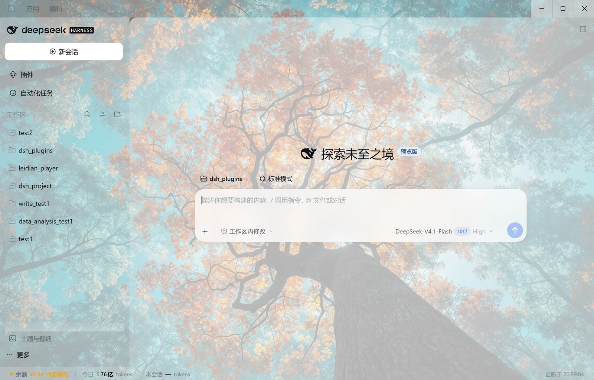
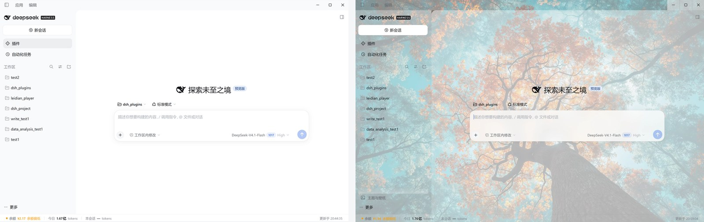
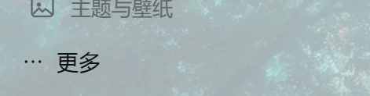

# dsh-wallpaper-theme

> **DSH Harness 桌面端插件**：给 Harness 窗口换壁纸——本机图片、浅色/深色各一张、历史图库、渐变预设，并把界面调成可读的磨砂玻璃。

[](https://github.com/topics/dsh-plugin)
[](LICENSE)

> 配套插件：[dsh-api-usage-meter](https://github.com/yunshu-iii/dsh-api-usage-meter) —— 窗口底部的 API 余额与 token 用量状态栏。



同一界面开启壁纸前后（左：原生外观；右：开启壁纸）：



入口在侧栏底部：



## 它是什么

侧栏底部（设置按钮上方那排）多一个「主题与壁纸」按钮，侧栏收起时自动变成纯图标。点开是一个居中面板：上传本机图片当窗口壁纸，按浅色 / 深色分别设置，管理图库与渐变预设，并逐项调节界面材质。

壁纸**整窗铺满**，不再是“把面板调透明”那种做法——文字可读性交给每个表面自己的玻璃下限。

## 两种布局

| 布局 | 效果 |
|---|---|
| **铺满**（默认） | 壁纸从窗口一边铺到另一边；对话区盖一层可调的“画布地板”，侧栏更透，卡片/弹窗/设置页保持接近实心 |
| **浮窗** | 应用变成浮在壁纸上的圆角卡片，四周留 0–64px 边距，边距里壁纸 100% 原样显示 |

## 功能

- **先改草稿，点「应用」才生效**：选图、调滑杆、开轮换都只改面板里的草稿；关闭弹窗会丢弃未应用的修改。
- **浅色 / 深色各一张**：只设了一套时另一套自动沿用。
- **图库**：上传过的图片全部保留（默认最近 30 张），点选即用，悬停删除（点两次确认）。
- **渐变预设**：6 套内置浅/深渐变，不用存图片。
- **自动轮换**：开关 + 间隔（1 / 3 / 6 / 12 / 24 小时），在库内图片之间轮换。
- **外观切换**：面板里直接切 浅色 / 深色 / 跟随系统，与设置里的偏好是同一份。
- **数值可直接输入**：每个滑杆右侧是数字框，回车或失焦生效；百分比 1% 一档。
- **每个滑杆都有独立说明**，固定挂在对应项下方。

## 参数

| 参数 | 范围 | 说明 |
|---|---|---|
| 布局 | 铺满 / 浮窗 | 见上表 |
| 画布地板 | 30–70% | 对话区那层玻璃的可读下限，越低壁纸越明显 |
| 侧栏地板 | 25–70% | 侧栏单独的下限，比画布更透 |
| 输入栏不透明度 | 50–100% | 输入框单独一层底（默认 94%）+ 18px 磨砂 |
| 弹窗不透明度 | 50–100% | 设置弹窗自身的不透明度（默认 97%） |
| 卡片边距 / 卡片底色 / 侧栏磨砂 | 浮窗专用 | |
| 面板虚化 | 0–40px | 面板背后的磨砂强度 |
| 壁纸强度 / 壁纸模糊 / 暗化 | 0–100% / 0–40px / 0–80% | 壁纸自身的浓度、虚化和黑色蒙层 |
| 填充方式 | 铺满 / 适应 | |

分级兜底：卡片层 88% / 91% / 94%，输入框 94% + 独立磨砂，所以调低画布地板不会把设置页一起调透。

## 安装

### 方式一：命令行（推荐）

```bash
# 桌面端
dsh plugin --profile desktop add github:yunshu-iii/dsh-wallpaper-theme

# Web 端
dsh plugin --profile web add github:yunshu-iii/dsh-wallpaper-theme
```

装完重启 Harness 生效。也可以从插件页「安装第三方插件」选择本仓库，或先装 [dsh-plugin-market](https://github.com/TheYoungChen/dsh-plugin-market) 在市场里一键安装。

## 存储

```
$DSH_HOME/wallpaper-theme/
├── index.json          图库索引 + 当前选择 + 参数
└── files/<id>.<ext>    图片本体（按内容哈希命名，重复上传自动去重）
```

- 单张上限 20MB，图库 30 张 / 300MB，超出时淘汰最旧且未被使用的。
- 上传前浏览器先缩到最长边 2560px 的 WebP，12MP 照片通常只有几百 KB。
- 图片**只存本机**，不上传任何服务器，也不走附件 / 会话通道。

## 实现要点

- 壁纸画在插件自持的 constructable stylesheet 里：`html::before` 固定定位、三层叠加（淡出底 → 暗化 scrim → 图片）。
- 「壁纸强度」用底色渐变实现而不是 `opacity`，保持这一层始终不透明——否则面板的 `backdrop-filter` 会静默失效。
- 铺满模式只改 token：`--dsw-alias-bg-base`（画布地板）、`--dsw-specific-sidebar-fill`（侧栏地板）、`--dsw-alias-bg-layer-1/2/3`（卡片）、`--dsw-specific-input-major`（输入框）。三列各读自己的 token 画背景，所以“对话区磨砂、侧栏更透、卡片接近实心”是同一张表算出来的。
- 桌面壳兼容：清掉 `--dsh-desktop-frame-fill`、`.dshDesktopFrame` 的背景与 extended/advanced 模式下 `.dshDesktopSidebarSurface` 的不透明底。
- 禁用兜底：客户端每 10 秒探一次宿主接口（单次 5 秒超时）；404 / 超时 / 连接失败都算“宿主不在了”，撤掉壁纸并隐藏按钮，重新启用后自动恢复。
- 卸载时整张样式表清空，所有覆盖同时消失。

## 已知限制

- 右上角的最小化 / 最大化 / 关闭是 Windows 原生窗口按钮，由系统绘制在网页之上，网页 CSS 无法覆盖；要统一需要主进程 `setTitleBarOverlay`。
- 个别控件若用了写死的颜色（不走 token），壁纸在那一小块上透不出来。
- 只做壁纸与表面材质：不改变强调色、字体、圆角等设计 token。
- 不做多方案分组保存（如「工作日 / 周末」两套）；浅深两套是最小单位。
- 轮换只在页面打开时检查——应用关着不会跳图。

## License

[MIT](LICENSE) © yunshu-iii
